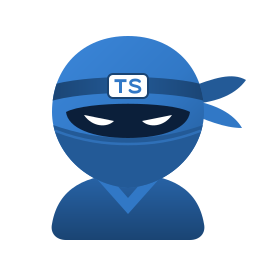

<p align="center">
  
  
</p>

<p align="center">
  <em>An end-to-end, zero-dependency TypeScript client SDK generator for <a href="https://django-ninja.dev">Django Ninja</a> APIs.</em>
</p>

<p align="center">
  <a href="https://www.python.org/">= 3.12" /></a>
  <a href="https://www.djangoproject.com/">= 6.0" /></a>
  <a href="https://django-ninja.dev/">= 1.8.0" /></a>
  <a href="https://opensource.org/licenses/MIT"></a>
</p>

---

Inspired by the architecture and developer experience of [**Gota**](https://github.com/carlosxfelipe/gota) (a minimalist REPR Go framework with native TypeScript SDK generation), this project brings the same seamless type safety to Django Ninja and Python.

## 🎯 Purpose

Bridge the gap between Python backend models and TypeScript frontends without requiring Node.js codegen toolchains (`openapi-typescript-codegen`, `orval`, `hey-api`, etc.):

- **Pydantic to TypeScript**: Schemas automatically become clean TypeScript interfaces with JSDoc annotations (`@example`, `@default`, etc.).
- **Strict Union Types**: `Literal["low", "normal", "high"]` becomes `"low" | "normal" | "high"` instead of a loose `string`.
- **Typed Endpoint Catalog**: All routes are mapped in `NinjaEndpoints` with strict typing for path params (`{id}`), query parameters, request bodies, and responses.
- **Zero-Dependency Client**: Emits a standalone `createNinjaClient()` runtime powered strictly by native `fetch`, `Headers`, `URLSearchParams`, and `FormData` (works in browsers, Node 18+, Deno, and Bun).

## 📦 Installation

Install the package directly into your Django project using `uv` or `pip`:

**Using `uv` (recommended):**

```bash
uv add "git+https://github.com/carlosxfelipe/django-ninja-ts.git#subdirectory=packages/django-ninja-ts"
```

**Using `pip`:**

```bash
pip install "git+https://github.com/carlosxfelipe/django-ninja-ts.git#subdirectory=packages/django-ninja-ts"
```

*(Once published to PyPI, it will also be available via `uv add django-ninja-ts`)*.

> **Requirements:** Python 3.12+, Django 6.0+, and Django Ninja 1.8.0+ (automatically installed as dependencies if not already present in your project).

### Django Configuration

1. **Register the app in `settings.py`** (required for management commands like `generate_ts_sdk`):

```python
INSTALLED_APPS = [
    ...,
    "ninja_ts",
]

# Optional: dotted path to your NinjaAPI instance (auto-discovered if you only have one)
NINJA_TS_API = "config.api.api"
```

2. **Serve the SDK in development (optional)** — in your `api.py`, after registering routers:

```python
import ninja_ts

ninja_ts.install(api)  # Exposes GET /api/sdk.ts and /api/types.d.ts when DEBUG=True
```

## 🚀 Quickstart

### 1. Development & Demo Setup

This project is managed with [Astral's `uv`](https://astral.sh/uv):

```bash
uv sync
```

### 2. Run the Django API

```bash
uv run python manage.py runserver
```

The server will start at `http://localhost:8000`:
- **Scalar API Docs**: [http://localhost:8000/api/docs](http://localhost:8000/api/docs)
- **OpenAPI 3.x Spec**: [http://localhost:8000/api/openapi.json](http://localhost:8000/api/openapi.json)
- **TypeScript Client SDK**: [http://localhost:8000/api/sdk.ts](http://localhost:8000/api/sdk.ts) (active in `DEBUG=True`)
- **TypeScript Type Definitions**: [http://localhost:8000/api/types.d.ts](http://localhost:8000/api/types.d.ts) (active in `DEBUG=True`)

### 3. Generate the SDK offline (CI/CD)

Export the standalone SDK or `.d.ts` declarations directly to disk without running an HTTP server:

**Full standalone client SDK:**

```bash
uv run python manage.py generate_ts_sdk -o ./sdk/api.ts
```

**Type declarations only (`.d.ts`):**

```bash
uv run python manage.py generate_ts_sdk --types-only -o ./sdk/api.d.ts
```

### 4. Zero-Build Frontend Demo

A zero-build Vue 3 frontend (replicated from `gota/examples/frontend`) is included in `frontend/`:

Simply open `frontend/index.html` in your browser while the Django server is running to interact with the API, test real-time validation, and inspect the client.

## 📦 Workspace Structure

This repository is organized as a `uv` workspace:

- `packages/django-ninja-ts/`: The standalone, publishable PyPI library (`django-ninja-ts`).
- `config/` & `apps/`: The Django example app demonstrating how to use the package.
- `frontend/`: Zero-build browser frontend consuming the generated SDK.

## 🧪 Tests & Quality

### 1. Test Suite & TypeScript Type Checking

Run the test suite (includes end-to-end type checking with the TypeScript compiler `tsc`):

```bash
uv run pytest packages/django-ninja-ts
```

### 2. Code Quality & Formatting (Ruff)

Run the formatting and linting script (runs `ruff check --fix`, `ruff format`, and `shfmt`):

```bash
./fmt.sh
```

### 3. Build Distribution Packages

Build the distribution packages (`.whl` and `.tar.gz`):

```bash
uv build --package django-ninja-ts
```

## 📄 License

MIT
